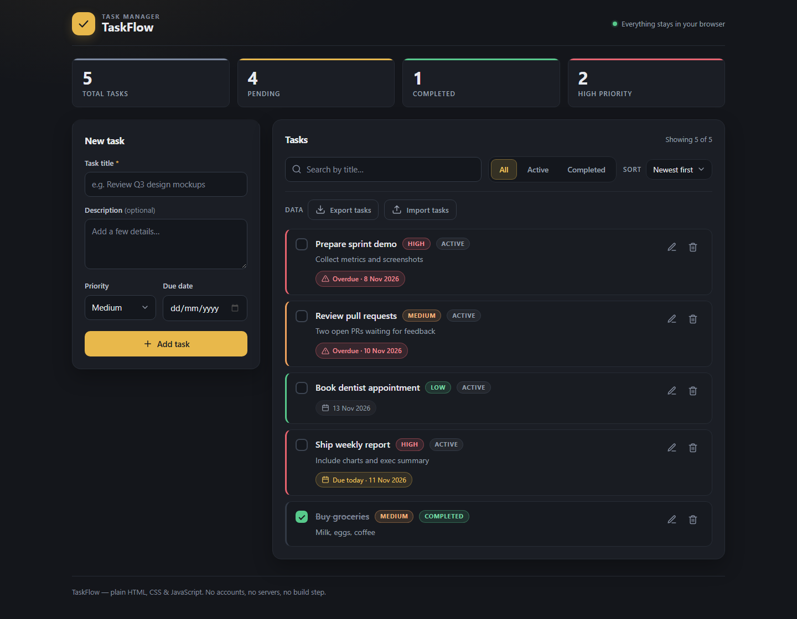
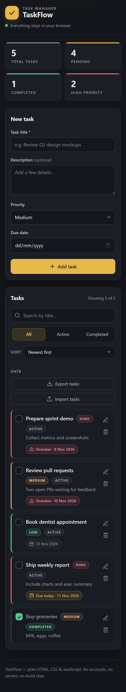

# TaskFlow

A polished, local-first task manager built with **plain HTML, CSS and vanilla JavaScript** — no frameworks, no build step, no servers. Dark charcoal interface with a warm gold accent, designed to stay out of your way while you capture and finish work.

## Screenshots





## Features

- Add, edit, complete and delete tasks — each with a title, optional description, priority and due date
- Filter by all / active / completed, search by title, and sort by newest, oldest, A–Z, due date or priority
- Live statistics: total, pending, completed and high priority
- Overdue, due-today and upcoming date indicators
- Export every task to a dated JSON file and import it back, with validation and confirmation before anything is replaced
- Inline validation, protection against accidental double-submissions, and confirmation before deleting
- Keyboard friendly: `Enter` submits, `Esc` cancels an edit or clears the search, `/` jumps to search
- Responsive from desktop down to 390px, with visible focus states and screen-reader announcements
- Everything persists in LocalStorage and survives reloads; invalid or corrupted stored data is repaired on load

## Tech stack

- HTML5
- CSS3 (custom properties, grid/flex, animations, media queries)
- Vanilla JavaScript (ES2020+)
- LocalStorage for persistence
- Node.js built-in test runner for the automated tests

## Project structure

```
todo-list-app/
├── index.html             # App markup
├── style.css              # Design tokens, components, responsive rules
├── script.js              # UI logic: rendering, events, storage, import/export
├── taskflow-core.js       # Pure task logic and file format, shared with the tests
├── tests/                 # Automated tests (run with: node --test)
│   ├── tasks.test.js        # Creation, validation, editing, deletion
│   ├── storage.test.js      # LocalStorage round-trips and repair
│   ├── visibility.test.js   # Filtering, search, statistics, due dates
│   ├── sorting.test.js      # Sort keys and stable ordering
│   ├── importexport.test.js # Export format, import validation, merging
│   └── edgecases.test.js    # Review regressions: id safety, character caps
├── screenshot-desktop.png
├── screenshot-mobile.png
├── README.md
└── .gitignore
```

## How to run locally

No build step and no dependencies.

1. Clone this repository.
2. Open `index.html` in any modern browser.

That's it. Alternatively, serve the folder with any static file server.

## Tests

The suite runs on Node's built-in test runner — nothing to install:

```bash
node --test
```

It covers task creation and validation, editing, deletion, completion, filtering, search, sorting, statistics, due dates, LocalStorage repair, the export/import format and the edge cases found during the final review. Requires Node.js 18 or newer.

## LocalStorage

- Tasks are stored in your browser under the `taskflow.tasks` key and saved immediately after every change
- Nothing ever leaves your device — there are no accounts and no network requests
- Clearing your browser's site data for this page removes the tasks
- Missing, invalid or corrupted stored data is detected on load and the app starts fresh instead of crashing

## Export & import

- **Export tasks** downloads every task as `taskflow-tasks-YYYY-MM-DD.json` — ids, titles, descriptions, priority, due dates, completion state and an export timestamp. Exporting an empty list is fine.
- **Import tasks** accepts a TaskFlow export or a plain JSON array of task objects, validates the structure and every field, and rejects malformed files with a clear message instead of touching your data.
- Invalid ids and duplicate ids inside a file are rejected, and tasks you already have are never overwritten unless you confirm the replacement.
- New tasks are added on top of your list, LocalStorage is updated immediately and the view is refreshed.
- Files larger than 1 MB are refused, so a stray file cannot stall the tab.

## GitHub repository

[github.com/PrathamSinha07/TaskFlow](https://github.com/PrathamSinha07/TaskFlow)

## Author

**Pratham Sinha**
